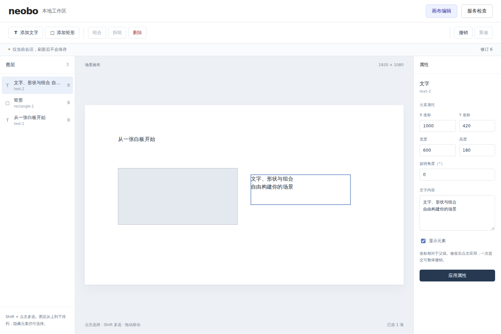

# 0011：二维画布与可撤销编辑闭环

- 日期：2026-10-23（Asia/Shanghai）
- 状态：已完成（并行开发、统一 review、真实浏览器验收通过）
- 关联：[ADR 0005](../decisions/0005-canvas-editor.md)

## 目标

将已有统一命令和历史内核接入二维画布，验证文字、矩形的绘制、选择、拖动与组合交互，保留服务检查入口。

## 实际变化

- 默认进入空白画布，支持文字/矩形添加、图层与画布选择、Shift 多选、属性应用、隐藏/显示、删除、组合/拆组及撤销/重做。文档更新统一经过既有命令和历史，内容仅在当前会话，刷新后不保存。
- 按用户确认，不连续同级元素可以组合，新组占最高选中层；组内原顺序和未选节点彼此顺序保持。拆组恢复父坐标下的位置、旋转和子节点顺序；隐藏组合拆开后直接子元素仍隐藏。
- 共享包增加世界四角与几何规划，复用既有校验和命令，覆盖嵌套旋转、祖先/后代去重、49/50 个直接目标边界及数值/结构限制。修订号耗尽保持原错误码。
- 只读 SVG `SceneView` 与编辑器分开；文字用安全文本和原生换行，组合不缩放或裁剪子元素，默认中性表现不扩展样式协议。
- 拖动经真实 SVG 屏幕矩阵转换，预览独立，释放时一次提交，零位移不记历史。取消、失去捕获、Escape、失焦、隐藏和卸载释放资源；旧修订失败后同步最新内存状态，允许重新操作。
- 服务检查页保留既有连接、重试、超时和 StrictMode 资源测试；切换视图不丢编辑。Web 增加共享包依赖，首次构建继续按依赖顺序执行。
- 新增固定 Playwright 1.64.1 开发依赖和本地浏览器验收入口；Vitest 与浏览器测试分别收集，两者均被类型和静态检查覆盖，测试产物加入忽略规则。按用户确认，耗时的浏览器安装/回归不放入 CI，构建、类型、静态与单元/集成测试等基础门禁保留。

## 验证

| 命令或检查          | 实际结果                                                                                                                      |
| ------------------- | ----------------------------------------------------------------------------------------------------------------------------- |
| 工具链与冻结安装    | Node.js 24.22.1、pnpm 12.15.0；`pnpm install --frozen-lockfile --ignore-scripts` 通过                                         |
| `pnpm check`        | 通过：工具 36、Scene 191、API 96、Web 50，共 373 项测试；全部包 build、lint、typecheck 通过                                   |
| `pnpm test:browser` | 8 项 Chromium 回归通过：增改删/服务切换、非连续组合与旋转拆组、真实 CTM/画布外释放、取消、隐藏取消、旋转组/子拖动、窄屏与换行 |
| 视觉检查            | 1440×960 实际截图已人工查看；验证界面、选中轮廓、中文排版和默认文字可读性；未声称像素基线比较或性能数据                       |
| `pnpm audit:deps`   | 通过高危门槛，仍报告既有 1 项低危通告                                                                                         |
| actionlint 1.7.12   | 通过；复用与仓库固定 SHA-256 一致的已校验工具，检查移除浏览器安装/回归后的工作流                                              |
| 几何与资源 review   | 世界四角/旋转父位移不变量、修订冲突恢复、捕获释放、StrictMode 监听对称与隐藏视图取消均有回归证据                              |

首轮浏览器启动因宿主缺少 NSS/NSPR/ALSA 运行库失败，已从系统官方源仅下载并解包到隔离目录后执行；中文字体同样隔离补齐，未安装系统包或修改个人配置。首次探索测试还修正了 Testing Library 与 Playwright 选项混用，以及文本框定位方式；最终上述检查全部通过，没有跳过或吞错。

本次浏览器进程、Vite 测试服务、临时运行库/字体、报告和对应字体缓存已清理。浏览器工具本身是明确加入的开发依赖；下图作为交付证据保留，不属于临时产物。远端 CI 以推送后的实际结果为准。

首次远端 CI 已通过代码基础检查，但浏览器及系统依赖安装耗时较长，按用户要求主动取消。后续移除这两个 CI 步骤，真实浏览器验收以上述本地结果为准；取消的任务不计为通过。

截图中的示例由测试交互创建；首次进入仍为空白场景，不含预置业务布局。

## 遗留问题

- 当前仅有文字、矩形与组合的本地编辑；场景存储、身份授权、发布快照、组件注册、图表、主题、三维、动画及 AI 尚未实现。
- 旋转和尺寸通过表单应用；未实现尺寸手柄、画布平移/缩放、框选或吸附。组合宽高是边界和旋转中心，不缩放子元素。
- 已验证 Chromium 桌面和窄屏；其他浏览器、真机触控和长时间性能仍待验证。编辑器/播放器尚未独立打包。

## 下一步

推进组件注册和图表渲染验证，再继续独立播放器、主题与三维；不把本次本地会话能力当作已经实现的服务端保存或权限。
