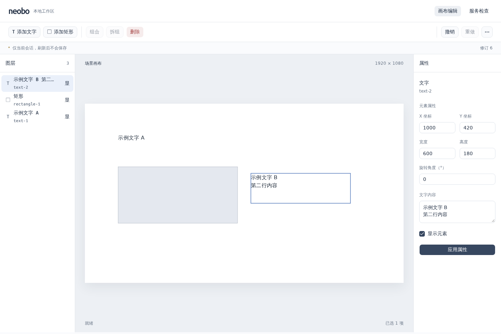
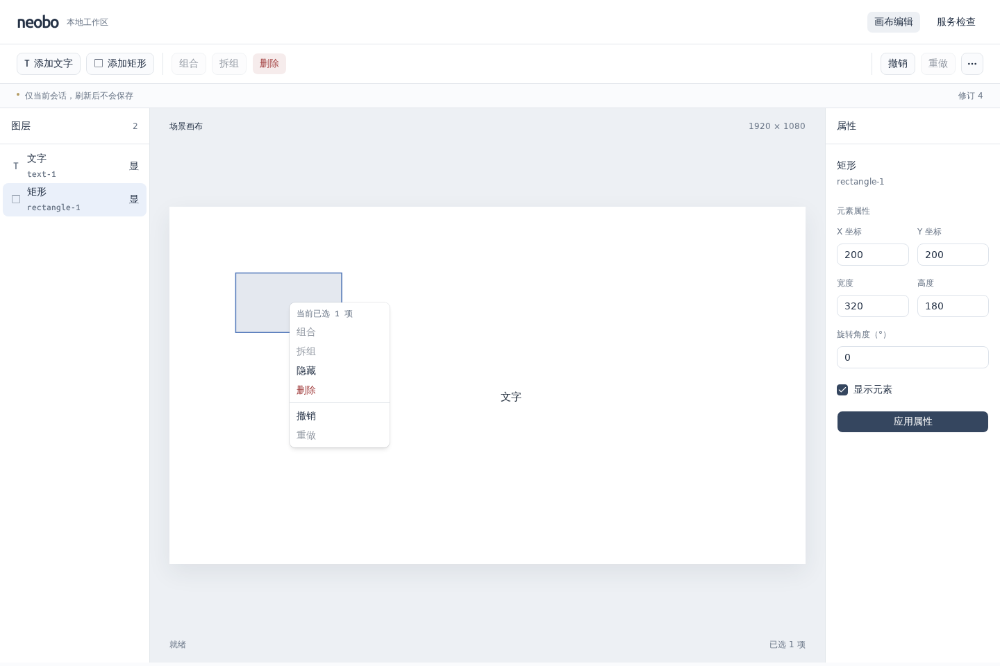

# 0013：shadcn 环境与统一编辑菜单

- 日期：2026-10-23（Asia/Shanghai）
- 状态：已完成（并行开发、统一 review 与本地浏览器验收通过）
- 关联：[ADR 0006](../decisions/0006-editor-ui.md)

## 目标

按用户确认，本轮先完成 shadcn/ui 安装配置、统一页面样式和右键编辑菜单；暂不开发图表或组件注册。

## 实际变化

- 接入官方 Radix + Nova 组件源码、Tailwind CSS 4.3.3 及 Vite 插件，统一 TypeScript、Vite 和 Vitest 别名；固定所需依赖，保留 MIT 许可及现有代理/严格检查。
- 按官方 eject 方式保留所需 CSS 状态变体，移除带未修复高危间接依赖的常驻 CLI；按需生成组件的 `ui:add` 固定 shadcn 4.22.1，不在正常安装或 CI 运行。
- 应用与编辑器共用颜色、字体、圆角、间距及公共控件；清理宣传、用途、教学与后续计划文案及失效样式，保留标签、状态、错误和刷新丢失风险。用户场景内容不随应用 UI 变量改变。
- 画布、图层及可见“更多操作”菜单复用已有删除、组合、拆组、显隐、撤销和重做。右键未选对象切换目标，已选对象及选中祖先的后代保持选区，空白处保持选区并明确数量。
- 菜单打开/取消不新增历史，菜单与拖动互斥，隐藏、修订冲突和卸载关闭浮层并释放锁；键盘、焦点和定位复用 Radix。
- 浏览器发现新文本域的内容尺寸与 fieldset 默认最小宽度共同撑破窄屏，已限制属性表单收缩边界，保留长文本回归；没有通过隐藏页面溢出来掩盖问题。

## 验证

| 命令或检查                                         | 实际结果                                                                                                                  |
| -------------------------------------------------- | ------------------------------------------------------------------------------------------------------------------------- |
| `pnpm dev:doctor`                                  | 通过：Node.js 24.22.1、pnpm 12.15.0、现有配置及 Docker/Compose 前置条件正常                                               |
| `pnpm install --frozen-lockfile --ignore-scripts`  | 通过，不需要安装脚本                                                                                                      |
| `pnpm --filter @neobo/web ui:add button --dry-run` | 通过：识别现有配置并预览单个组件，无实际覆盖                                                                              |
| `pnpm check`                                       | 通过：35 份 Markdown、格式/链接/仓库规则；工具 36、Scene 191、API 96、Web 64，共 387 项测试，全部包构建/类型/静态检查通过 |
| `pnpm test:browser`                                | 12 项 Chromium 回归通过；截图增加动画结束断言后，对应菜单用例单独重跑通过                                                 |
| `pnpm audit:deps`                                  | 通过高危门槛，仅既有 1 项低危；未添加忽略规则或跳过审计                                                                   |
| 并行开发与统一 review                              | 通过：页面与菜单定向测试、依赖审查、最终只读 review；根 agent 统一复核命令复用、CSS 隔离、依赖/许可、焦点和资源           |
| 视觉检查                                           | 1440×960 实际截图已查看，确认统一控件、中文与最终菜单状态；未做像素基线比较或性能验收                                     |

浏览器验证覆盖原有增改删、几何、拖动与取消，以及右键目标、多选/组合、键盘 Shift+F10、Escape 焦点返回、隐藏释放、窄屏菜单定位、长文本收缩和场景绘制隔离。jsdom 仅补齐 ResizeObserver 接口，不用其断言真实布局。宿主缺少浏览器系统运行库及中文字体，本次从系统官方源下载到隔离目录供本地验收使用；未安装系统包或修改个人配置。

本次浏览器与 Vite 测试进程、临时报告、隔离运行库、字体和缓存已清理；仅保留以下交付截图。远端 CI 以提交后的实际结果为准，本轮未增加工作流步骤。

截图中的元素由测试创建；页面默认仍为空白，不包含预置业务场景。

## 遗留问题

- CLI 按需执行时仍需核对官方来源及新增依赖；归入项目的公共 CSS 和组件由本仓库维护，不自动跟随上游覆盖。
- 已验证 Chromium 桌面、窄屏及键盘，未做其他浏览器、真机触控或性能验收；没有新增暗色切换器。
- 场景仍仅保留当前会话，刷新后不保存；图表、组件注册、存储、权限、场景主题、三维及 AI 尚未实现。

## 下一步

按路线图继续组件注册与图表验证，实施前确认首个图表及数据范围；本轮不把未采用的图表建议当成已确定需求。
