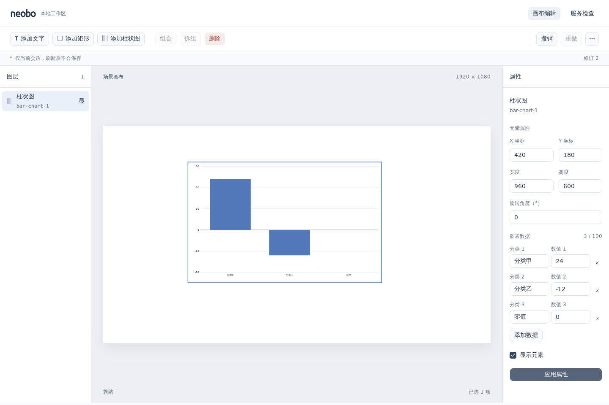

# 0015：静态单系列柱状图

- 日期：2026-10-23（Asia/Shanghai）
- 状态：已完成（并行开发、统一 review、本地验收与文档检查通过）
- 关联：[ADR 0008](../decisions/0008-static-bar-chart.md)、[场景组件说明](../../apps/web/src/scene/README.md)

## 目标

按用户确认，实现分类名称与数值组成的静态单系列柱状图，支持添加、属性编辑、删除和撤销，暂不连接数据源；完成统一 review、实际浏览器验收及文档同步后提交 PR。

## 实际变化

- 共享契约新增 `bar-chart` 组件版本 1，静态 `data` 每行只允许 `category` 与 `value`。空数据合法，新增图表默认空白；最多 100 条、分类 1–100 个 Unicode 码点且非纯空白、有限数值绝对值不超过 `1e12`，允许负数与零。文档及命令均在解析前拒绝超长数组，不回显非法数据。
- `node.update.changes.data` 仅用于柱状图，全量替换并保留原子提交与深拷贝隔离；图表沿用修订、容量限制、添加/删除、组合与撤销/重做。旧 Scene v1 样例保持兼容，新样例固定新组件；旧读取器遇到新类型会明确拒绝，不伪造前向兼容或迁移。
- 编辑器从注册入口创建 480×320 的居中空图表，使用统一公共控件编辑分类/数值草稿与增删行。草稿不会改变画布，一次应用形成一步历史；非法数据拒绝，同值不增加修订，删除行保持相邻输入焦点。
- ECharts 6.1.0 按需注册柱图、直角坐标和 SVG，逻辑尺寸显式传入，场景继续掌管位置/旋转/命中。关闭图表动画和交互，数据完整替换；等值文档副本及拖动不重复配置，只有尺寸改变才 resize。
- 通过 React.lazy 延迟加载实际图表模块，外层保留命中框和错误边界。覆盖加载完成前卸载、模块加载失败、初始化/配置/尺寸异常、StrictMode、隐藏、删除及卸载的资源释放。运行异常可随数据/尺寸变化恢复；模块下载失败没有自动重新下载。
- 固定新增依赖及锁文件，构建输出完整 `licenses.md` 与 ECharts 官方 NOTICE；API 继续复用共享 Pipe，仅扩充测试控制器回归，生产路由和 CI 工作流未变。

## 验证

| 命令或检查                                               | 实际结果                                                                                  |
| -------------------------------------------------------- | ----------------------------------------------------------------------------------------- |
| `pnpm install --frozen-lockfile --ignore-scripts`        | 通过，锁文件一致，无需安装脚本                                                            |
| `pnpm check`                                             | 通过：全部包构建/类型/静态检查；工具 36、Scene 233、API 102、Web 125，共 496 项测试       |
| `pnpm test:browser`                                      | 本地 14 项 Chromium 回归全部通过，包含 2 项新增图表绘制、编辑、几何、显隐与窄屏回归       |
| `pnpm audit:deps`                                        | 通过高危门槛，依赖树仅报告 1 项低危；新增 ECharts/zrender/tslib 官方批量审计未返回通告    |
| 产物与许可检查                                           | 首屏 JS 482.17 kB / gzip 151.97 kB；图表异步块 471.51 kB / gzip 161.00 kB，无默认体积告警 |
| `pnpm format:check`、`pnpm lint:docs`、`pnpm check:repo` | 最终同步后通过，覆盖 40 份 Markdown 的格式、结构及仓库内链接检查                          |
| 并行开发与统一 review                                    | 共享契约、编辑界面、渲染并行完成；根 agent 统一审查、API/E2E 验收及独立交叉 review 均通过 |

同步加载原型的首屏 JS 为 952.94 kB；根据真实构建结果改为按需加载。上述数字仅是本次构建的静态体积，不代表加载时间、运行帧率或支持规模。构建生成的 `licenses.md` 已核对包含 ECharts、zrender 和 tslib，NOTICE 已核对进入产物且正文与官方包一致。

新增浏览器用例已按拆组后保持多选的既有规则补齐单选步骤，全量复验通过。真实验收包含正/负/零值 SVG、类别文本与标记安全、数据缩减无旧项残留、数据/元素删除撤销、显隐重建、旋转组合拆分与窄屏表单；1440×960 截图已查看。测试数据仅用于验收，应用默认仍为空白场景。

浏览器依赖和中文字体从系统官方源解包到隔离临时目录，未安装系统包或修改个人配置。测试自建 Vite/Chromium、临时报告及隔离库/字体/缓存已清理，仅保留上方交付截图。远端 CI 以本次提交的实际结果为准；本地浏览器验证未加入 CI。

## 遗留问题

- 场景仅保留当前会话；静态手填数据不等于数据源查询、持久化或授权。
- React.lazy 缓存模块加载结果，下载失败后需恢复网络并刷新；刷新会丢失未保存的当前会话。未增加通用重试加载器。
- 未验证其他浏览器、真机触控或长期性能；多系列、其他图表、主题、三维、动画与 AI 仍按后续需求实现。

## 下一步

推进编辑器与播放器独立打包，让只读入口消费当前场景及已注册组件，验证构建边界与资源释放；存储、动态数据和权限继续按路线图分阶段实现。
