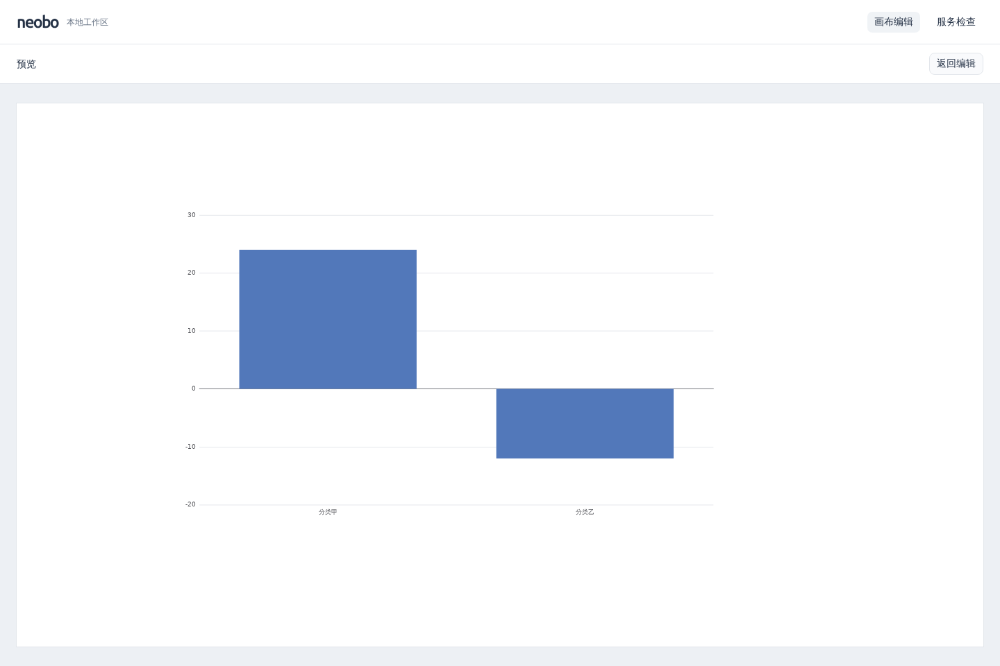

# 0016：独立只读播放器与场景预览

- 日期：2026-10-23（Asia/Shanghai）
- 状态：已完成（并行开发、统一 review、本地验收与文档检查通过）
- 关联：[ADR 0009](../decisions/0009-readonly-player.md)、[播放器开发说明](../../packages/player/README.md)

## 目标

按路线图拆分编辑器与播放器，提供不携带编辑代码的只读消费入口，复用现有组件绘制；完成提交态预览、资源释放、真实浏览器和构建边界验收，同步文档后提交 PR。

## 实际变化

- 新增私有工作区包 `@neobo/player`，独立输出 ESM JavaScript 与类型声明。注册表、文字/矩形/静态柱状图和组合绘制迁入该包；React 为 peer，ECharts 运行依赖从 Web 移入，沿用现有固定版本。删除旧 Web 场景目录，节点创建工厂和相关测试迁至编辑器。
- 共享包新增 `@neobo/scene/document` 公开子路径，只读消费者仅引入文档与严格校验。场景 schema、组件版本和命令保持兼容，播放器不导出节点工厂、命令、历史、选择、拖动或应用 UI。
- `ScenePlayer` 接收 unknown，消费校验后的独立文档；非法输入、未知版本和绘制错误显示固定反馈，非法替换卸载旧画面。低层 `SceneView` 和注册表供已校验文档与受信任源码复用，不增加任意类型或远程插件。
- 编辑器增加“预览”，读取当前提交态，不包含属性草稿或拖动临时位置，不增修订。返回保留选区、草稿、历史和撤销/重做，焦点回到编辑入口。隐藏编辑器卸载绘制，离开预览卸载播放器；实际图表只驻留当前视图，保留懒加载及既有失败/销毁语义。
- 预览壳复用公共按钮和设计变量，画布按剩余宽高等比适配，未添加用途或开发说明文字。只读入口没有编辑控件、菜单或快捷键处理。
- 开发命令依次构建 Scene、Player，再监听 Scene/Player/API/Web，增加蓝色 `[PLAYER]` 标签。修复首次构建中收到停止信号后继续启动下一阶段的问题，收尾移除自身信号监听；新增真实 concurrently 子进程回归。
- 新包接入全部根检查及 React Hook 规则，独立消费者使用已编译公共出口，验证实际生产模块图与懒加载产物引用。CI 未增加浏览器步骤。

## 验证

| 命令或检查                                        | 实际结果                                                                                                                      |
| ------------------------------------------------- | ----------------------------------------------------------------------------------------------------------------------------- |
| `pnpm install --frozen-lockfile --ignore-scripts` | 通过，5 个工作区含根目录，锁文件一致；仅重接工作区依赖，无供应商版本变化                                                      |
| `pnpm check`                                      | 通过：4 个业务包构建/静态/类型检查；工具 38、Scene 233、API 102、Player 48、Web 96，共 517 项测试                             |
| `pnpm test:browser`                               | 本地 16 项 Chromium 回归全部通过；新增预览提交态/只读交互、返回草稿/历史、反复切换图表与窄屏验证                              |
| Player 浏览器用例定向复验                         | 新增低高度横屏后 2 项通过，覆盖 1440×960、960×540、390×844，检查画布宽高适配及无横向溢出                                      |
| 独立消费者生产构建                                | 原生 Node 导入 dist 成功；真实 Vite 模块图无 Web/应用 UI、Radix、命令/历史/几何规划；所有 chunk 引用存在，ECharts 保持懒加载  |
| 开发启动与退出烟测                                | Scene→Player→四包监听，编译零错误，API 健康/Web 均 HTTP 200；Ctrl+C 后进程退出及端口释放；首次 Scene 构建中取消不启动后续阶段 |
| `pnpm audit:deps`                                 | 通过高危门槛，仅报告 1 项低危                                                                                                 |
| 产物许可核对                                      | Web `licenses.md` 包含 ECharts/zrender/tslib；产物 NOTICE 与 public 原文一致                                                  |
| 文档与交叉 review                                 | 更新 README、开发/架构/启动说明、路线图、ADR 和迭代；统一 review 及独立交叉 review 后通过格式、结构和本地链接检查             |

独立消费者测试仅在内存构建，不使用 Web 配置或源码别名；JS 与声明的 `.js` 相对导入、依赖顺序均按当前官方资料和实际构建验证。单元测试隔离 ECharts 边界，实际 SVG 图表与布局由 Chromium 验收；不以 jsdom 或压缩字符串搜索代替证据。

1440×960 的实际预览截图已查看并保留：

浏览器依赖和中文字体从系统官方源解包至隔离目录，未修改系统安装和个人配置。测试自建 Vite/Chromium、临时报告、隔离库/字体/缓存及开发监听均已清理，保留交付截图和正常构建产物。远端 CI 以本次提交实际结果为准，浏览器验收继续保留在本地。

## 遗留问题

- 当前为可嵌入的静态只读播放器与本地会话预览，没有发布站点、发布快照、存储、权限或动态取数；刷新仍丢失当前编辑。
- React.lazy 的模块下载失败不自动重新下载；既有图表运行失败恢复边界保持不变。
- 未验证其他浏览器、真机触控或长期性能；没有新增主题、三维、动画或自定义业务类型。

## 下一步

推进主题接口和两个不同风格的小型验证包。首批可配置字段、主题默认值与具体表现需在实现前确认；继续保持编辑/播放同文档及布局不变，后续再验证三维与动画。
