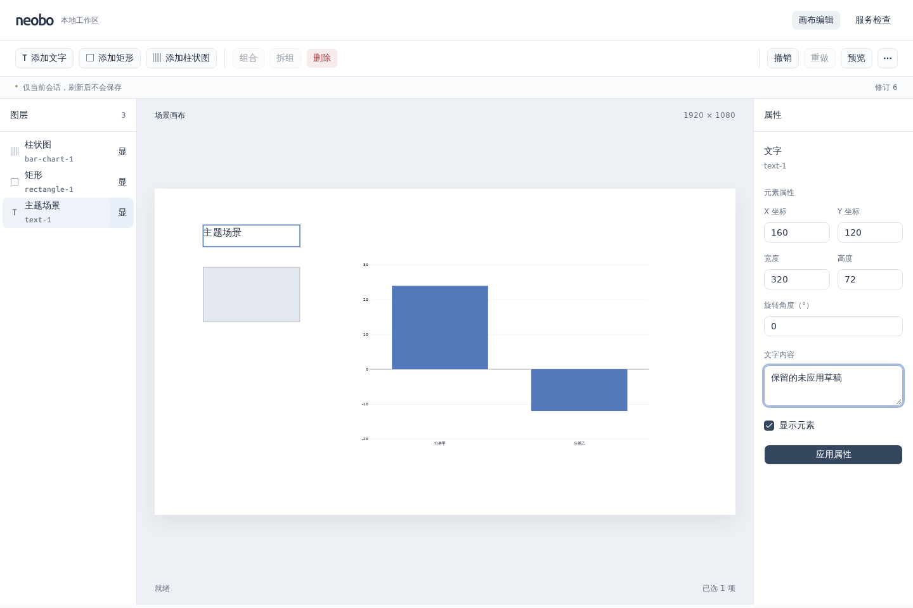
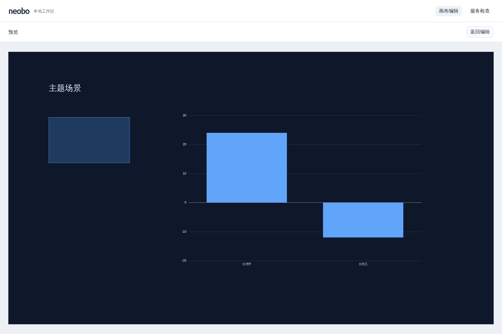

# 0017：两套场景主题与可撤销切换

- 日期：2026-10-23（Asia/Shanghai）
- 状态：已完成（并行开发、统一 review、本地验收与文档检查通过）
- 关联：[ADR 0010](../decisions/0010-scene-themes.md)、[主题开发说明](../../packages/theme/README.md)

## 目标

按用户确认，提供中性浅色、深色蓝两个固定场景主题，覆盖背景、文字、矩形和柱图配色，切换可撤销且编辑/预览一致；统一验收、更新文档后提交 PR。

## 实际变化

- 新增框架无关的 `@neobo/theme`，复用现有 Zod，严格校验版本化引用和八个实色 token，公开预设为冻结数据。主题不依赖 React、ECharts 或服务端；本轮不引入供应商版本升级、远程加载或可执行主题。
- Scene v1 新增可选主题引用，旧 fixture 缺省时仍保持原文档结构，按中性浅色绘制。未知标识、版本、类型和额外字段拒绝，安全错误不回显输入。新读取器接受旧文档，旧读取器会拒绝带新字段的文档，不宣称前向兼容或已有迁移。
- `scene.theme.set` 复用修订、原子批次和统一历史；覆盖混合命令失败、冲突、容量、输入/结果隔离及撤销恢复缺字段。节点组件版本、几何、树和静态数据不变。
- 播放器统一先画场景背景，内部 Context 给文字、矩形和柱图提供稳定 token。柱图同时更新柱色、文字、坐标轴与网格；切换复用实例，不 resize，等值文档/主题不重复 setOption。失败恢复增加有效主题变化条件，保留懒加载和配对释放。
- 画布/图层右键菜单和“更多操作”共用场景主题单选子菜单，空白场景及键盘可用，拖动/隐藏期间禁用。当前有效主题不执行命令、不消耗修订或清空重做栈。场景主题与应用 UI 风格分开，没有新增解释文案或全局深色开关。
- 属性表单按已提交节点值变化重置，主题切换及仅主题撤销/重做保留选区、草稿、错误和表单状态；真实节点修改仍刷新。预览读取带主题的提交态文档，返回保持草稿及历史。
- 开发入口首次构建 Theme→Scene→Player，再启动 Theme/Scene/Player/API/Web 五包监听，增加黄色 `[THEME]` 标签。保留首次构建中断短路与信号监听清理，根检查实际覆盖新包。

## 验证

| 命令或检查                                        | 实际结果                                                                                                      |
| ------------------------------------------------- | ------------------------------------------------------------------------------------------------------------- |
| `pnpm install --frozen-lockfile --ignore-scripts` | 通过，6 个工作区含根目录；仅新增工作区依赖接线，无供应商版本变化                                              |
| `pnpm check`                                      | 通过：5 个业务包构建/静态/类型；工具 38、Theme 16、Scene 256、API 107、Player 60、Web 109，共 586 项测试      |
| API 主题用例定向验证                              | 两个请求边界测试文件共 40 项通过，含主题输入、HTTP 切换/撤销/重做、非法引用拦截与混合失败回滚                 |
| `pnpm test:browser`                               | 本地 Chromium 18 项全部通过；新增两套实际配色、布局/数据不变、草稿/选区、主题撤销、预览一致及窄屏键盘菜单回归 |
| 独立消费者生产构建                                | 使用已编译公共出口，含主题 dist、不含主题源码及编辑链；四个播放器运行出口不变，ECharts 继续懒加载             |
| 开发启动与退出                                    | 三包顺序构建、五包监听零编译错误，API 健康/Web 均 HTTP 200；Ctrl+C 后全部退出且端口释放                       |
| 首次构建取消                                      | 实际 Theme 首次构建中取消后未启动后续包；工具回归覆盖三个构建阶段、信号监听释放与真实 concurrently 子进程收尾 |
| `pnpm audit:deps`                                 | 通过高危门槛，仅报告 1 项低危                                                                                 |
| 文档与 review                                     | 代码与独立交叉 review 无阻塞；同步主题、架构、启动、场景/播放器说明、路线图和迭代后，格式/结构/链接检查通过   |

图表单元测试隔离第三方边界验证实例与调用，Chromium 验证实际 SVG 背景、文字、矩形、柱、坐标轴与网格颜色。1440×960 的浅色编辑和深色预览截图均已查看；窄屏为 390×844，既有预览用例继续覆盖 960×540 横屏。上述证据不代表长期性能或其他浏览器结果。

浏览器运行库和中文字体从系统官方源解包至隔离目录，未修改系统安装或个人配置。自建 Vite/Chromium、临时报告、库/字体/缓存和开发监听已清理，仅保留交付截图与正常构建产物。远端 CI 以本次提交实际结果为准，浏览器未加入 CI。

## 遗留问题

- 当前仅两套固定整场景实色预设；逐元素固定覆盖、自选色、字体、素材、效果、动态主题包发现及加载仍未实现。
- 场景继续只在当前会话，保存、授权、发布快照和动态数据尚未实现；不将本地主题预览视为发布。
- 未验证其他浏览器、真机触控或长期性能。三个遗留 Action 升级仅完成官方兼容性资料核对，未在本轮修改或合并，需单独升级验收。

## 下一步

推进三维渲染验证，先确认首批对象、素材来源和交互范围，再实施编辑/播放的一致绘制与资源释放；动画和完整主题包能力继续按路线图推进。
